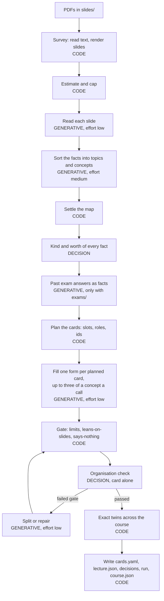
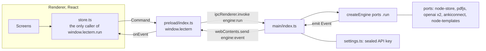

# Lectern v3: architecture

How the code of `v3` works, written from the code. The code is the truth; where this file and the
code disagree, the code wins and this file is wrong. Places in code are cited by symbol (for
example `settleMap` in `tree.ts`), never by line number. What is not built yet is an issue, listed
in section 15. Why it is built this way is in the RFDs (`docs/rfd/`, index in `docs/README.md`).

Lectern turns a course's lecture PDFs into Anki cards. A student creates a course, drops in one PDF
per lecture or the folder that holds them, states a goal, and the app writes cards and sends them to
Anki.

## 1. Layout of the repository

| Path | What it is |
| --- | --- |
| `packages/engine` (`@lectern/engine`) | The headless engine. Plain TypeScript, run by Node with type stripping, no build step, no interface code. Everything that makes cards lives here. |
| `packages/app` (`@lectern/app`) | The Electron desktop app. A shell and a React interface around the engine. |
| `design/` | Design kit (`KIT.md`) and the card field contract (`cards/FIELDS.md`). The Anki templates and the stylesheet the engine installs live in `packages/engine/anki/`. |
| `docs/` | Decisions as RFDs (`rfd/`, index in `README.md`), the status, this file. |
| `eval-results/` | Git-ignored. Real course folders and run logs. |

The v2 app lives on the `main` branch. Nothing in v3 imports it.

Engine runtime dependencies (`packages/engine/package.json`): `openai`, `pdfjs-dist`,
`@napi-rs/canvas` (renders slides to PNG), `yaml`, `zod`. Tests use `vitest` and `pdf-lib`.

### Engine source tree

```
src/api.ts            the boundary: createEngine(ports).run(command, emit)
src/commands.ts       CommandSchema and the Event type: what crosses the boundary
src/ports.ts          every dependency from outside: Store, PdfPort, ModelPort, DecisionsPort, AnkiPort, TemplatesPort
src/build.ts          the build and estimate commands: the whole pipeline
src/ask.ts            the one place that spends money: metering and the cap
src/decide.ts         the closed lists, the decision questions, ORGANISATION_THRESHOLD
src/mapper.ts         the slide reading and the sorting of facts: prompts and reply schemas
src/tree.ts           code that builds, checks and repairs the map
src/exams.ts          past exam papers: questions, families, answers
src/plan.ts           code that plans the cards
src/writer.ts         the card forms and the fill, repair and split calls
src/presets.ts        the preset: card types per fact kind, examples, rules
src/clash.ts          exact twins among the questions of a course
src/cost.ts           the estimate and the cap constants
src/course.ts         the course folder: shapes, paths, read and write
src/slides.ts         slide text without the lines every slide repeats
src/library.ts        non-building commands: courses, course, cards, slide, create, add, move
src/sort.ts           the kind of an added file: name rules, the choice question, SORT_THRESHOLD
src/edit.ts           slots, edit, remove, write (single cards)
src/deliver.ts        send (Anki)
src/cards/            roles, validate, slots, card, fields, id, words, question-answer
src/adapters/         openai, pdfjs, node-store, node-templates, ankiconnect, memory-anki, offline, fake
src/cli.ts            command line: estimate, build, send (LECTERN_FAKE=1: offline models, Anki in memory)
eval/                 bench.ts, refdeck.ts, read-slides.ts and the judge instructions (section 14)
anki/                 four card templates and style-native.css
```

## 2. The three kinds of actor

Every step of the pipeline is done by exactly one of these. The design rule ([RFD 2](rfd/0002-code-decides.md)): the model never
decides how many cards exist or what shape they take. Code owns numbers and structure, the
generative model only writes words into small forms, the decision model only answers closed
questions.

**Plain code and rules (no model).** Reading PDFs, the estimate, checking and repairing the map,
planning the cards, ids, validators, markup, tags, decks, the cap, all file and Anki handling. Pure
functions wherever possible.

**The generative model.** One port, `ModelPort` (`ports.ts`), one real adapter, `openaiModel`
(`adapters/openai.ts`). Provider OpenAI, Responses API, strict JSON schema output, `store: false`.
Default model id `gpt-6-luna`; the only other priced id is `gpt-6.1-terra` (`PRICES` in
`openai.ts`). The CLI takes `--model`, the app uses the default. Five tasks (`Task` in `ports.ts`),
each with a closed reply schema:

| Task | Effort | Asked in | Returns |
| --- | --- | --- | --- |
| `read` | `low` | step 5 below, one call per slide | the facts one slide states or shows |
| `map` | `medium` | step 5b, one call per lecture | title, topics, concepts, the facts in each |
| `fill` | `low` | step 10 | one filled form for one card type |
| `repair` | `low` | step 12 | the same form again, after rejection |
| `split` | `low` | step 12 | two or three forms of the same type |

The exam steps (section 3, 7a) run on the same port under the tasks above. Every request carries
the lecture as `context` (slides as `[n] line / line`, slides under 100 characters of text also as
PNG images), a `system` text (`SYSTEM` in `mapper.ts`: "You only fill forms ... Use only what the
slides say, in the language of the slides ... no em-dashes") and a `prompt`.

**The decision model.** One port, `DecisionsPort` (`ports.ts`), one real adapter,
`openaiDecisions` (`openai.ts`): OpenAI's Decisions API, `client.decisions.create`, model
`gpt-6-luna`, input tokens only. It takes one shared input (text and optional images) and a list of
closed questions, and returns one answer per question and no text. A question is a `predicate`
(answer: a probability from 0 to 1), a `choice` (answer: one of the listed values) or a `score`
(answer: a position on an ordered list of levels); a missing answer is a `refusal` and counts as
no verdict (`createAsk` in `ask.ts`). Requests go out in chunks of 200 questions
(`QUESTIONS_PER_REQUEST`) and at most 128 images (`MAX_DECISION_IMAGES`). The decision model
returns no explanation and no accuracy figure; Lectern sets thresholds itself (section 4).

Both models go through `createAsk` (`ask.ts`), which meters every call.

## 3. The pipeline, step by step

`build` (`build.ts`) runs four phases that the app shows as the run screen: `read`, `map`,
`write`, `check`. Only PDFs not yet in `course.json` are built. `read` and `map` run over all
new lectures at once, since the plan shares the goal's cards out over the whole build. `write`
and `check` then run one lecture after the other, so they overlap in the events, and each
lecture is saved as soon as it is through (step 16).



### The whole pipeline in one table

| # | Step | Actor | Input | Output | Where |
| --- | --- | --- | --- | --- | --- |
| 1 | Survey | code | PDF bytes | Text lines per slide without the lines every slide repeats; a PNG (1024 px wide) of every slide; the slides with under 100 characters of text left count as pictures for the model | `survey` in `build.ts`, `slides.ts`, `adapters/pdfjs.ts`, `LOW_TEXT_CHARS` in `cost.ts` |
| 2 | Estimate and cap | code | characters, slide and image counts, goal, past papers, model prices | `estimate` event: cards, `costUsd`, `costEur`, `capUsd` | `estimate` in `cost.ts` |
| 3 | Read each slide | generative, `low`, one call per slide | The lecture as text (cached), the slide's picture, a narrow question | The facts this slide states or shows, each with the name of its concept; a set named as one fact | `askSlide` in `mapper.ts` |
| 4 | Sort the facts | generative, `medium`, one call per lecture | The lecture, every fact with an id, the course vocabulary | Title, topics, concepts with their fact ids, and the ids of repeats | `askGroups` in `mapper.ts`, `fromGroups` in `tree.ts` |
| 5 | Settle the map | code | The sorted facts, earlier concepts | A tree that is always usable | `settleMap` in `tree.ts` |
| 6 | Kind of fact | decision | The lecture as text plus the pictures of the slides the facts come from; one `choice` question per fact | One of nine kinds per fact (`FACT_KINDS`) | `kindsOf` in `build.ts`, `ask.factKind` in `decide.ts` |
| 7 | Worth of a fact | decision | One fact with the name of its concept, as the whole input of its own request | A score from 0 to 3 on four levels, stored on the fact | `factInput`, `WORTH_LEVELS` in `decide.ts` |
| 8 | Past exams | generative: one call per new paper, one for all questions, one per family | Paper text; all questions with the lectures and their concepts; one family's question with its lecture's slides | Questions (`exams.json`); families placed in a lecture and concept; per family one answer fact | `exams.ts`, `addExamAnswers` and `examFact` in `build.ts` |
| 9 | Plan | code | The topics and slide counts of all lectures of the build, the worth of every fact, goal, preset | A list of slots per lecture: concept, fact, card type | `plan` in `plan.ts` |
| 10 | Ids | code | Slot, lecture, concept id, role | `<lecture>-<concept>-<role>-<n>` | `cardId` in `cards/id.ts` |
| 11 | Fill | generative | The whole lecture, concept, fact, card type, preset rules, one example of the type | One filled form | `createWriter` in `writer.ts` |
| 12 | Gate | code | The slots | A list of problems, empty means pass | `validateDraft`, `leansOnSlides`, `saysNothing` in `cards/validate.ts` |
| 13 | Split or repair | generative | The rejected slots, every problem, the same brief | A fixed form, or two or three forms | `writer.repair`, `writer.split` |
| 14 | Store | code | Passing slots, place in the course, slide text | The card as stored: slots in plain text, lecture, concept, slide, excerpt, exam | `fromDraft` in `cards/slots.ts`, `toCard` in `cards/card.ts` |
| 15 | Organisation check | decision | The card alone: question and answer | Probability that the card is about course organisation; at 0.2 or more the card is dropped | `ORGANISATION_THRESHOLD`, `cardInput` in `decide.ts` |
| 16 | Exact twins | code | Questions of new cards against earlier and new cards | An identical question is dropped | `findClashes` in `clash.ts` |
| 17 | Save | code | One finished lecture | `cards.yaml`, `lecture.json`, `decisions.json`, `course.json`; with the last lecture `exams.json`; once per run `runs/NNN.json` | `saveLecture`, `saveExams`, `build` in `build.ts` |
| 18 | Send | code through AnkiConnect | Cards not yet in Anki | Decks, note types, media, notes | `send` in `deliver.ts` |

### Step by step

**1. Survey (code).** `survey` (`build.ts`) lists `slides/*.pdf` in course order (by file name,
numbers compared as numbers, `inCourseOrder` in `course.ts`), skips files already listed in
`course.json`, reads text per slide with pdf.js, drops the lines that at least half the slides
repeat (footer, page number, compared without digits, `withoutFurniture` in `slides.ts`), and
renders every slide to a 1024 pixel PNG. Slides with fewer than 100 characters of text left
(`LOW_TEXT_CHARS`) go to the model as pictures with every request; the others are read from text,
and the picture of a slide is added to the one call that reads that slide. No slide is left out for
lacking text: the model gets to see the picture. Each lecture gets a number: the leading number of
the file name if free, otherwise the next free one, and it keeps that number forever
(`assignNumbers` in `course.ts`). The survey also finds the past papers in `exams/` that
`exams.json` does not list yet. It serves `estimate` too, which renders pictures locally and calls
no model.

**2. Estimate and cap (code).** See section 5. The `estimate` event is emitted before the first
paid call.

**3. Read each slide (generative model).** One call per slide (`askSlide`), effort `low`. The
model gets the lecture as text, which the provider caches, then the picture of this one slide and a
narrow question: every fact this slide states or shows. Several things under one heading come
first as one fact naming all of them, then one fact per part only when the slide says more about
it. The first slide goes ahead to fill the cache. Why: one call for a whole lecture skimmed it (the
measurement is in the comment at the top of `mapper.ts`).

**4. Sort the facts (generative model).** One call per lecture (`askGroups`), effort `medium`. It
gets every fact with an id and returns the title, topics, concepts with their fact ids, and the ids
of facts that repeat another. `fromGroups` builds the map; a fact the model forgot is kept under the
concept the reading named for it, and a repeat is left out.

**5. Settle the map (code).** `settleMap` checks the map and repairs it itself: empty or too long
title (`TITLE_CHARS`), unnamed concepts, facts on slides that do not exist, facts without text,
more than 12 facts per concept (`FACTS_PER_CONCEPT`, the rest is cut), concepts named twice (one id
from the name alone, a slug plus a short hash when it holds symbols like `++`; the later facts join the first). It returns the tree and the slides no
concept uses (`leftOut`, reason "No testable fact on this slide"). Nothing is asked again. A concept
whose id exists in an earlier lecture keeps the stored name and gets `since: <lecture>` (one
vocabulary).

**6. Kind of fact (decision model).** One `choice` question per fact among `definition`,
`contrast`, `list`, `sequence`, `formula`, `code`, `case`, `diagram`, `cause`. The shared input is the
lecture; the request carries only the pictures of the slides its facts come from, at most 128 per
request. An invalid or missing answer falls back to `definition`.

**7. Worth of a fact (decision model).** One request per fact, the fact and the name of its concept
as the whole input (`factInput`), one `score` question: "How much is this fact worth learning for
the exam of the course?" on four levels: not examinable, detail, examinable, core
(`WORTH_LEVELS`). The answer, 0 to 3, is stored on the fact as `worth`. It only orders facts; it
drops nothing. A fact without an answer counts as examinable (`WORTH_UNKNOWN`). Why: the order in
which the map lists facts says nothing about what an exam asks; the measurement is in the comment
on `WORTH_LEVELS`.

**8. Past exams (generative model).** Only when the course folder has an `exams/` folder with
papers not read before, and only in a build that has new lectures. The student adds papers with the `add` command
(`to: 'exams'`; "Past exams" in the course setup of the app), which stores them in `exams/`. Each new paper goes to the model whole and comes back as its
questions, kept in `exams.json`. One call then sorts all new questions into families that ask for
the same answer and places each family in a lecture of this build and a concept of it. One call per
family, with that lecture's slides as context, writes the answer as one fact and says whether the
slides hold it; when they do not, the model answers from what it knows. The fact carries the
family's question and how many papers asked it, gets a kind like every other fact, and goes first in
its concept, so that of two cards asking the same, the exam's is kept. Only questions of papers new
in this build are placed: the questions of older papers already have their cards. Why: the
measurement is in the comment at the top of `exams.ts`.

**9. Plan (code).** `plan` is a pure function and the only place that decides how many cards exist:

- The goal is a number of cards per slide, at most (`GOAL_PRESETS` in `cards/roles.ts`): `pass`
  0.5, `good` 1, `top` 1.8. Top grade is the size of the reference deck a student built for the
  exam.
- The cards are shared out over all lectures of one build (`budget`), not lecture by lecture:
  slides are a poor measure of what a lecture holds (the measurement is in the comment on `plan`).
  A lecture added later is a build of its own.
- Answers to past exam questions first, the most often asked first. Then the facts worth most.
  Equal worth keeps the order of the map.
- An exam answer takes the first card type of its kind and does not move the turn of the concept's
  other facts. Its card shows how many papers asked it (`Asked`) and, when the model wrote the
  answer, the Source "Past exams; the answer is not on the slides" and no slide.
- A concept that an earlier lecture introduced (`since`) stands for exactly `RECURRING_CARDS` (1)
  more card, its best fact, whatever the goal.
- The kind of a fact and the preset pick the card type from `preset.plan[kind]`, taken in turn
  within one concept. A `list` fact of exactly 2 items becomes `name-two`.
- A concept the goal leaves without a card is returned as `beyondGoal` and named in the decisions.

**10. Ids (code).** `cardId` (`cards/id.ts`) is `<lecture>-<concept id>-<role>-<n>`. The wording is
not part of it, so a reworded card keeps its id, its place in the file and its Anki note. Ids are
fixed by the plan, before a word is written.

**11. Fill (generative model).** One call per concept for up to three of its planned cards
(`CARDS_PER_CALL`, `createWriter` in `writer.ts`), effort `low`. The input is the whole lecture as
text again (`cardContext`, cached by the provider), then the pictures of the call's own cards'
slides only, then the concept name, per card the fact and its slide, the card type with a one-line
description (`ROLE_SPECS[role].use`) and the preset's example of that card type, then the preset's
`rules` once. The reply is a list of forms, each tagged with its card type; every call has that one
reply format, so the provider's cache of the lecture holds for all of them. A card the reply leaves
out or writes in another form is asked again on its own. Each card type has a small form (`FORMS`
in `writer.ts`) with the limits written into the field descriptions: for example a definition has
`question`, `answer`, `extra`; a contrast has `question`, two sides, two values, `extra`. The model
never writes HTML, list markup, slot labels, cloze numbers of a list, or any provenance field. The
first call of each lecture runs ahead of the others to fill the provider's prompt cache. Why three
cards and only their own pictures: the lecture, and above all its pictures, made most of every
call's input, and the key's tokens a minute hold the build; judged blind, neither change lost
anything ([RFD 4](rfd/0004-lecture-to-cards.md)).

**12. Gate, split and repair.** For every filled card, `validateDraft` (all hard limits, section 9),
then, only if that passes, `leansOnSlides` (the question points at the slides or the session, a
word rule in English and German) and `saysNothing` (the answer repeats the question, a sentence
only turns the question around, a contrast side repeats its own label). Problems are sentences
written so that a model can act on them. Cards that fail go back, at most twice (`REPAIRS`). A card
that breaks a length limit (`tooLong`) and is not yet a part is split: the model returns two or
three atomic forms (`SPLIT_INTO`), the first part keeps the id, the others get new ids, and each
part goes through the gate again but is never split again. Every other failure is repaired: the
same form again with the previous attempt and the full list of problems. A card that still fails
after two rounds is dropped and listed in `lecture.json` with concept, role, question and reasons.

**13. Store (code).** `fromDraft` takes the model's marks out of the text: the `==x==` of an
answer becomes its key term, kept apart from the answer, and the deletions of a gap sentence become
its hidden parts with their positions (`at`); any other `==x==` (in the question or lead-in, a label,
the extra, or a second mark in one answer) has no place in the slots and is unwrapped to its words.
`toCard` adds where the card comes from: lecture, concept, slide, `excerpt` (the slide line sharing
most terms, at most 30 words, empty when the answer is not on the slides) and the exam it answers.
That is what `cards.yaml` holds: plain text, no HTML.

The fields of `design/cards/FIELDS.md` are built from the stored card by one function,
`cardFields` in `cards/fields.ts`, when a card is sent or shown: escaped HTML with the key term in
`<mark>`, `Back` by role, `Slots` labels, cloze text for `cloze` and `cloze-list` (the list items
become `{{cN::...}}` items), `Source` ("Lecture 2, slide 14"), `Excerpt`, `Slide` (an `` named
`l02-s14.png`), `Diagram` (the slide image, for the `diagram` role only), `Key` (the concept name).
`Typed` is always empty and `Part` is always empty.

**14. Organisation check (decision model).** One request per card that passed the gate, the card
alone as the input (`cardInput`): predicate "This flashcard is about the organisation of the
course: the lecturer, dates, grading, exam rules, assignments, reading lists, guest visits or
instructions for a class exercise." At or above `ORGANISATION_THRESHOLD` (0.2) the card is dropped
at once with the reason "is about the organisation of the course, not its subject", with no
repair, because no rewording fixes such a fact. Below, nothing happens. The threshold was measured
on two full runs; the figures are in the comment on the constant.

**15. Exact twins (code).** `findClashes` compares each new card's question, as a set of lowercase
words, with all earlier cards and the new ones before it. The same word set is dropped, reason
"asks the same question as <id>". An existing card is never the one that is dropped. No card is
rewritten here.

**16. Save (code).** The rule: a lecture is saved when its cards are through the check, in this
order, and `course.json` lists it last, so an interrupted build never leaves a half-built lecture
counted as built. Per lecture: `cards.yaml` (the accepted cards), `lecture.json` (the tree,
left-out slides with reasons, dropped cards), `decisions.json` (lines written by code from
facts: goal, left out, beyond the goal, recurring concepts, concepts without a card, dropped
counts; the lines of this lecture from an earlier run that did not finish are replaced), then its
entry in `course.json`. The cards of a saved lecture join the course at once, so the clash check
of the next lecture sees them. With the last lecture, before its entry in `course.json`, come
`exams.json` and the decision about the papers: papers count as read only when every lecture
their questions were placed in is saved, so a stopped run asks them again. `runs/NNN.json`
(models, goal, calls, decisions, tokens, estimate, cost in dollars and euros, durations per
phase, the lectures and cards saved) is written once, when the build ends. A build that stops
writes it too, marked `failed`, so money spent on it shows, and keeps the lectures it saved. Build
again and only the rest is built and paid for.

### How the calls of a build run

All model calls and decision requests of a build share one queue (`createAsk`, `ask.ts`), 32 at
a time (`PARALLEL`). Of the calls waiting, the one with the highest priority goes first: the
sorting of each lecture's facts (`askGroups`) above everything, since every later step waits for
it; then the earlier lecture before the later one; past papers last. After the first failure no
call starts. What runs at once and what waits for what (`build.ts`):

- The reading of every slide of every lecture and the reading of past papers start together.
- The map of lecture n (sort and settle) waits for its own slides and the map of lecture n-1,
  whose concepts it names again (22 to 32 concepts of Entrepreneurship come up again in a later
  lecture). The kind and worth of its facts start as soon as its map is settled (`labelFacts`).
- Exam families wait for every map; the plan waits for every map, label and exam answer.
- Cards of all lectures are written and checked at once; clashes and saving go in course order,
  and the earlier lecture's calls go first, so lectures still finish, and are saved, in order.

The OpenAI adapter sends each lecture picture once, as a file that expires after a day, instead
of inside every call: sent inline, lecture 4 of Entrepreneurship (54 pictures) put 14 MB into
each of its card calls and the upload limited the build. Writing-model calls are paced to the
key's tokens a minute (`pace.ts`, [RFD 6](rfd/0006-money.md)). The sorting of facts and the exam
families run on the provider's faster tier at twice the price, since everything waits for them.

`runs/NNN.json` records `phaseMs` and, per step, its wall time, its calls, their time added up
(waiting for a place included) and the slowest (`steps`). Steps of different lectures overlap.

**17. Send (code).** Section 12.

### Events of a build

A build emits, in order: `phase` read started, `estimate`, `phase` read done, then `phase` and
`progress` for `map`, `write` and `check`, then `built` (lectures added, cards, dropped, cost,
duration). With nothing new to build it emits `phase` read started and done and an empty `built`.
A failure ends in `failed` with a message and a fix, never a throw (`createEngine` in `api.ts`).

## 4. Where each decision is made

| Judgement | Question to the decision model | Input | Outcome |
| --- | --- | --- | --- |
| Kind of fact | choice of 9, one per fact | lecture, with the pictures of the facts' slides | always applied; invalid answer gives `definition` |
| Worth of a fact | score on 4 levels, one request per fact | the fact and its concept name | orders the facts; nothing dropped |
| About course organisation | predicate | the card alone | at or above 0.2 (`ORGANISATION_THRESHOLD`): the card is dropped |

Everything else that rejects a card is code: the hard limits, `leansOnSlides`, `saysNothing`, and
the exact-twin rule. A check that has not been measured on labelled data does not run ([RFD 5](rfd/0005-decision-models.md)); that is why
only the organisation check exists as a decision that acts. Further checks are issue #105.

## 5. Where money is spent, the estimate and the cap

Money is spent in exactly two places, both wrapped in `createAsk` (`ask.ts`): each generative
model call and each decision request. Nothing else in the engine calls the network except
AnkiConnect on `127.0.0.1`, and `add` without a target shelf, which sends one decision request
per file it sorts (`sort.ts`), unmetered and without an estimate ([RFD 6](rfd/0006-money.md)).

- **Generative model**: `openaiModel` computes the dollar cost of each call from the usage the API
  returns: uncached input at `input`, cached input at `cachedInput`, output (reasoning included) at
  `output`; for `gpt-6-luna` that is 0.10, 0.01 and 0.50 dollars per million tokens, and when a
  request has more than 272,000 input tokens the long-context prices (0.20 and 0.75) apply to the
  whole request (`PRICES` and `LONG_FROM` in `openai.ts`). A call is reported as soon as the provider
  returns, even if the reply is then refused, so a failed call is still counted.
- **Decision model**: input tokens only at 0.10 per million. Cached input is billed at the full price
  here as an upper bound, because the real discount is not published.
- A reply that fails the zod schema is asked once more, so a call can be billed twice; after two
  bad replies the build fails.

**Estimate.** `estimate` in `cost.ts` is a pure function of per-lecture characters, slides and
image counts, the goal, the past papers and the two price lists. Its constants are the `TOKENS`
table in `cost.ts`, with the measurement behind each one in the comments there; they are not
repeated here. The cards it counts are the cards per slide of the goal times the slides. The result
is the `estimate` event: lectures, slides, cards, `costUsd`, `costEur`, `capUsd`. The `estimate`
command shows it without any model call; `build` emits it before the first paid call.

**What the student is shown.** `costEur` is the estimate in euros at a fixed 0.9 per dollar
(`EUR_PER_USD`), rounded up by `shownEuros`: to 5 cents up to 50 cents, 10 cents up to one euro, 50
cents above. The bottom bar of the app shows "About N cents" from it. Runs carry `costEur` too, by
the same conversion. The engine counts and caps in dollars.

**Cap.** `capUsd = max(3 x estimate, 0.25 dollars)` (`CAP_MULTIPLE`, `CAP_FLOOR_USD`), or the
command's own `capUsd` (CLI `--cap`). Before a call starts, `createAsk` reserves its expected cost
(`modelReservation` and `decisionReservation` in `cost.ts`: the input by the estimate's measures at
the full input price, the reply at the estimate's figure for that kind of call). A call that would
take the meter plus the reservations of the calls under way above the cap is not started, and
throws an `EngineError`. When a call ends, failed or not, its reservation is released and its real
cost is in the meter. `spend` still throws when the real cost is above the cap. Consequences:

- The run passes the cap only by how far the replies in flight cost more than their reservation,
  and by the repeated input of a decision request with more than 200 questions (the adapter sends
  it once per 200; `decisionReservation` counts it once). A hard limit needs an output limit per
  call: #303. After the first failure no call starts.
- The run fails, keeps the lectures it finished, and its run file records what it spent. Building
  again makes and pays only for the rest.
- The app passes no `capUsd`, so it always uses 3 times the estimate.

Paid runs are started only through the engine (`cli build`), on OpenAI, each preceded by its
estimate; `AGENTS.md` has the rules.

## 6. What the checks do

A card is rejected by code in three places: the hard limits and the two word rules (gate, with
repair), the organisation check (a drop), and the exact-twin rule (a drop). No check only flags:
a check either changes what is kept or does not exist. The organisation check was added, and its
threshold set, because the first runs showed that cards about course organisation were the
frequent defect that no rewording fixes. The threshold was measured over 1,150 cards (comment on
`ORGANISATION_THRESHOLD`).

The card check gets the card alone as its input, never the lecture: asked about a card while a
whole lecture was the input, the decision model said yes to nearly everything (`cardInput` in
`decide.ts`).

## 7. The preset

A **preset** (`Preset` in `presets.ts`) is the hand-written method for writing cards:

- `plan`: which card types a fact of each of the nine kinds becomes (taken in turn),
- `examples`: one filled form per card type, shown to the model,
- `mapRules`: what counts as a concept and a fact,
- `rules`: how a card is worded.

There is one preset, `CONCEPT`, and every course uses it. It was written from the Entrepreneurship
study kit and accepted as the working preset ([RFD 7](rfd/0007-presets.md)). Its map rules forbid course organisation as a concept
and ask for several angles per idea; its card rules say to lead with the key term, one fact per
answer, about 12 words, a context prefix when a rival answer exists. Its `plan` table:

| Fact kind | Card types, in turn |
| --- | --- |
| definition | definition, reverse |
| contrast | contrast |
| list | cloze-list (name-two when exactly 2 items) |
| sequence | chain |
| formula | formula |
| code | code |
| case | case |
| diagram | diagram |
| cause | why |

No command or setting changes the preset. Presets for other kinds of course are issue #194.

## 8. Card kinds and roles

The closed set of 12 card types, called roles (`ROLES` in `cards/roles.ts`). Each has a `RoleSpec`
with the note type, how many answers and labels, how `Back` is built, and a one-line `use` for the
prompt:

| Role | Note | Answers | Labels | Back |
| --- | --- | --- | --- | --- |
| definition | qa | 1 | 0 | sentence, key term marked |
| reverse | qa | 1 | 0 | one term |
| contrast | qa | 2 | 2 | two bullets |
| chain | qa | 1 to 2 | 1 to 4 | list |
| name-two | qa | 2 | 0 | two bullets |
| why | qa | 1 to 2 | 0 | sentence, or two bullets |
| case | qa | 1 | 0 | one term |
| formula | qa | 2 (TeX, condition) | 0 | formula plus sentence |
| code | qa | 1 to 2 | 1 to 2 | list, with a listing |
| diagram | qa | 1 | 0 | sentence; the slide image in the Diagram field |
| cloze | cloze | 0 | 0 | sentence with 1 to 5 deletions |
| cloze-list | cloze | 2 to 5 | 0 | lead-in with one deletion per item |

A `diagram` card has a front that asks to draw a framework in one sentence, one sentence for the
answer, and the slide's picture in the `Diagram` field. There is no drawing. Note types in Anki are
`Lectern Q&A` (16 fields) and `Lectern Cloze v3` (13 fields), the fields of `design/cards/FIELDS.md`
(`QA_FIELDS` and `CLOZE_FIELDS` in `deliver.ts`). Both carry a `Typed` field that is always empty.

## 9. Validation rules and hard limits

`LIMITS` (`cards/validate.ts`):

| Limit | Value |
| --- | --- |
| Front (question) | 20 words, never a yes/no opener (English and German list, `YES_NO`) |
| Answer, all answers together | 25 words |
| Bullets in a list or steps answer | 2 |
| Term answer (reverse, case) | 5 words |
| Extra | 40 words |
| Cloze sentence | 45 words, 1 to 5 deletions, each at most 8 words, numbered c1.. once each, no hints, balanced braces, at least 3 words of cue |
| Cloze list | lead-in 20 words, each item 8 words, 2 to 5 items |
| Slot label | 4 words |
| Code listing | 16 lines, 60 characters per line, every line must be found on the slide (skipped when the slide was seen as a picture) |
| Key term marks | at most one `==term==` per answer; definition requires one |

Further rules in `validateDraft`: the role exists, answer and label counts match the role, no empty
slot, plain text only (no line breaks, no HTML except `<sub>` and `<sup>`, no Markdown bold, no `$`
maths), the cited slide is a slide of the concept, only `code` takes a listing. Outside
`validateDraft`: `leansOnSlides` and `saysNothing` (section 3, step 12), which apply to
model-written cards only.

## 10. The course on disk

A course is a folder of plain files, no database (`course.ts`). The store root is the library
folder; a command carries the course as a folder name.

```
<course>/
  slides/*.pdf                    input, one PDF per lecture
  exams/*.pdf                     optional: past papers, added with the add command
  course.json                     format, name, goal, lectures: number, title, file, sha256, slides
  exams.json                      the questions of the papers read so far
  lectures/02/lecture.json        tree (topics > concepts > facts), left-out slides with reasons, dropped cards
  lectures/02/cards.yaml          the cards of the lecture, one readable file
  decisions.json                  decisions taken, one line each, written by code
  runs/001.json                   one file per build, failed ones too: models, tokens, cost, estimate, durations
  anki.json                       deck chosen, and the Anki note id of every card sent
```

Properties that hold by construction and by test:

- A lecture that is listed in `course.json` is never built again. Adding a lecture leaves the files
  of earlier lectures byte-identical.
- A lecture keeps its number forever (`assignNumbers`); a PDF is known by its file name. `add` with
  a target shelf refuses a name the course already has; `add` without one sorts each file
  (`sort.ts`, [RFD 5](rfd/0005-decision-models.md)), stores only lecture slides and past exams, and
  returns the rest as `left` with the reason, a name or a content the course already has among them. `move`
  shifts a file without cards between `slides/` and `exams/`. A changed PDF behind a built lecture is ignored (the sha256
  is stored, nothing compares it).
- A PDF that cannot be read (`UnreadablePdf` from the PDF port: a password, or damage) is refused
  by `add` with a target shelf, left out as `password` or `damaged` without one, before any
  request. One already in the course is marked `unreadable` on its pending lecture or paper in
  `course`, and `estimate` and `build` leave it out and name it (`unreadable` on the estimate); a
  build with nothing else to do fails with its name.
- Card files hold each card's slots in plain text (`role`, `front`, `answers` with their key term,
  `labels`, `hidden` with `at`, `extra`, `code`) and where it comes from (`lecture`, `concept`,
  `slide`, `excerpt`, `exam`, `own`), never HTML; an empty slot is left out. A course built
  before the slots were stored is built again. The Slide picture is not saved in the course
  folder: the `slide` command and `send`
  render it from the PDF on request.
- `createCourse` makes the folder name from a slug of the name and never reuses one, nor one that
  differs from it only by case (macOS and Windows take those for the same folder).
- `nodeStore` writes a file beside its target (`*.part`, never listed) and renames it over the
  target, so a crash or a quit leaves the old file or the new one. A file that no longer parses
  fails with its path (`damaged` in `course.ts`); such a course stays in the list under its folder
  name.

## 11. The boundary between the interface and the engine

One function: `createEngine(ports).run(command, emit)` (`api.ts`). Commands in and events out, both
plain data, so the in-app channel can later be swapped for HTTP. A command is parsed with a zod
discriminated union (`CommandSchema` in `commands.ts`); a bad command, or any thrown
`EngineError`, becomes a `failed` event with `message` and `fix`. Nothing throws out of `run`.
PDFs cross the boundary as `Uint8Array`: the `add` command carries each file as its name, or its
path inside the folder it came in, and its bytes. A slide picture leaves it as a base64 PNG in the `slide` event.

| Commands | Model or network? | Answered by events |
| --- | --- | --- |
| `build`, `estimate` | `build` calls both models, `estimate` neither | `phase`, `progress`, `estimate`, `built` |
| `add` | the decision model, for every file whose name does not keep it out, and only without `to` | `added` |
| `courses`, `course`, `cards`, `create`, `move`, `slide` | no model | `courses`, `course`, `cards`, `created`, `moved`, `slide` |
| `send` | AnkiConnect only | `sending`, `sent` |
| `slots`, `edit`, `remove`, `write` | none (Anki when the card is there) | `slots`, `edited`, `removed`, `written`, `refused` |

The engine touches no file system, network or PDF library itself. `Ports` (`ports.ts`) are passed
in: `store`, `pdf`, `model`, `decisions`, `anki`, `templates`, `now`.



The app side (`packages/app`):

- `src/shared/contract.ts` re-exports the engine's own types (`Command`, `Event`, `ShownCard`,
  `CourseState`, ...), so a change of the boundary fails the app's typecheck. The engine hands out
  each card with its fields from `cardFields`; the card list shows those, typeset with KaTeX.
- `src/main/index.ts`: handler `engine:run` builds an engine per command through `engineFor`
  (`src/main/engine.ts`), runs it and sends each event to the window as `engine:event`, then returns
  how many events it sent. The preload script waits for that many before the call resolves, because
  the "finished" answer can overtake the last events (`preload/index.ts`).
- `engine.ts` wires the ports: `nodeStore`, `ankiConnect`, `nodeTemplates` (reading
  `packages/engine/anki` in the repository, or, in a packaged app, the `anki` folder that
  `electron-builder.yml` copies into the app's resources, `process.resourcesPath`), `pdfjsReader`,
  `openaiModel` and `openaiDecisions` with the stored key. With `LECTERN_FAKE=1` it uses the offline models and a module-level `memoryAnki`
  instead.
- `src/main/settings.ts` holds what is not engine business: the OpenAI key, sealed with Electron's
  `safeStorage` (`openai.key`). `OPENAI_API_KEY` in the environment wins. The key never reaches the
  renderer.
- `src/renderer/src/store.ts` is the one zustand store and the only file that calls
  `window.lectern.run` (plus `SlideThumb.tsx` for slide pictures). A course's stage is derived
  (`stageOf`): `empty`, `setup` (PDFs pending), `running`, `ready`. The interface sends `build` with
  only `course` and `goal`. A topic is held by its index in the lecture, a concept by its id.
- Screens: first run (the key), courses, the course (a full-width map of lectures, a lecture as
  rings, a bottom bar, one side panel for setup, run, cards and card editor, details), settings (the
  key). Design is binding in `design/KIT.md`; the app's rules are in `packages/app/README.md`.
- Commands to run it: `pnpm --filter @lectern/app start`, with `LECTERN_FAKE=1` for the offline
  models and an Anki in memory. Environment: `LECTERN_FAKE_DELAY`, `LECTERN_COURSES`, `LECTERN_DATA`,
  `LECTERN_SHOW`; a packaged app ignores them.
- Installers: `pnpm --filter @lectern/app package` builds them with electron-builder into
  `packages/app/dist` (dmg, NSIS exe, AppImage). The engine is a development dependency, bundled
  into the main process; the installer ships only `@napi-rs/canvas` and `pdfjs-dist`, which load
  native code and data files at run time. A `v3.*` tag runs `.github/workflows/release.yml`,
  which builds all three on their own runners and puts them in one draft prerelease. Nothing is
  signed or notarised.

## 12. Sending to Anki

`send` (`deliver.ts`) needs Anki open with the AnkiConnect add-on (`127.0.0.1:8765`,
`adapters/ankiconnect.ts`, API version 6, 30 second timeout). It is the only delivery path.

1. Cards not in `anki.json` are collected per lecture. None waiting: fails with "Every card of this
   course is already in Anki."
2. `installNoteTypes`: creates the two note types from the four templates and `style-native.css` in
   `packages/engine/anki/` (read through `TemplatesPort`), or brings the ones in Anki to this version
   of them with `anki.restyle`. A note type is Lectern's to restyle only while its stylesheet starts
   with `/* lectern-notetype v<n> skin:`; a student who edits the styling removes the line and owns
   it. Native is the only card design (more are issue #193).
3. The course deck is chosen once and kept: the course name, or `<name> (Lectern)` when the student
   already has a deck of that name. One subdeck per lecture, `Course::02 Effectuation`.
4. Per lecture: the slide pictures are rendered from the PDF and stored as
   `lectern-<course>-l02-s14.png` (lowercase), then each card is added as a note with tags
   `<course>::lecture::02`, `<course>::role::<role>`, `lectern-id::<card id>` and, for the student's
   own cards, `<course>::own`. Duplicates are allowed (Anki would refuse an equal first field).
5. The `lectern-id::<card id>` tag marks the note of a card. Before every add, and after an add
   that failed, the send asks Anki for a note with that tag and adopts it instead of adding a second
   one: a call that timed out may have been applied.
6. Anki can hand back a note id for a note that is then gone (an undo by the student while the send
   runs removes Lectern's newest note). So the send asks Anki which notes exist, re-adds the missing
   ones up to 3 times (`ATTEMPTS`), and checks everything once more at the end; the count of notes
   that did not stay is the failure message. Only notes found in Anki are recorded. `anki.json` is
   saved in a `finally`, so an interrupted send continues with the rest.

A card is sent once: a note in Anki is never rewritten by a later send, and a note the student
deleted does not come back. Lectern does not touch any deck options or preset.

**Editing, removing, own cards** (`edit.ts`, `cards/slots.ts`):

- `slots` returns a card as a form holds it (role slots in plain text, key term apart from the
  answer, hidden parts of a gap sentence as a list) with the word limits, or blank slots for a new
  card. They are the slots `cards.yaml` stores.
- `edit` checks the form with `checkSlots` (messages written for a student), then `validateDraft`
  on `toDraft` (a `==` the student wrote is left out there, so only the key term reads as a mark),
  then stores the trimmed slots (`tidy`, `toCard`). The role cannot change. The card keeps its id, slide and place. The code listing
  check is skipped (`seenAsImage: () => true`) because a student may write what the slide only
  shows. If the card is in Anki, `updateSent` changes the note and keeps its progress; Anki is
  touched first, so with Anki closed nothing changes anywhere. A note the student deleted in Anki is
  forgotten and the card counts as not sent.
- `remove` deletes the note in Anki if there is one (`removeSent`), then the card from `cards.yaml`.
- `write` adds a card of the student's own to a concept: only `definition` (question and a
  one-sentence answer) or `cloze` (a sentence with gaps) (`OWN_ROLES`). The id takes the next free
  number, the slide is the first slide of the concept, `own: true` is set. It goes to Anki with the
  next send. `leansOnSlides` and `saysNothing` are not applied to the student's wording.

## 13. Offline models and tests

The pipeline never needs a network in tests. Everything outside the engine sits behind a port, so
tests pass scripted or in-memory versions:

- `adapters/fake.ts`: `scriptedModel(reply, costPerCall)` and `scriptedDecisions(answer)`. They
  record every request, so tests assert what the model was shown (for example that every card call
  carries the whole lecture and that card checks have the card as the only input). A scripted
  model can charge a fixed cost per call, which tests the cap.
- `adapters/offline.ts`: `offlineModel` and `offlineDecisions` need no script. They turn the text of
  any slides into a small course (each later slide with a heading and lines becomes a concept, each
  line a fact, each card made of the slide's words). Decisions give every fact a worth that depends
  on its text, the kind `definition`, and 0.1 to the organisation question. Cost is zero. They say
  nothing about real card quality. The app uses them with `LECTERN_FAKE=1`.
- `adapters/memory-anki.ts`: an Anki in memory that refuses what the real one refuses (unknown note
  type, field or deck, closed Anki) and models media, notes and tags.
- `test/helpers.ts`, `test/harness.ts`, `test/fixtures.ts`: real PDFs made with `pdf-lib`, a temp
  folder per test. The pipeline tests use the real pdf.js reader and renderer and real files; only
  the two models are scripted.

Engine test files, by what they cover: `build` (the pipeline), `checks` (the card checks and the
organisation threshold), `exams`, `cli`, `plan`, `tree`, `slides`, `validate`, `cards`, `library`,
`edit`, `deliver`, `ask` (the cap with calls in flight), `openai`, and `openai.live` (skipped unless `LECTERN_LIVE=1`; it costs a fraction
of a cent). `pnpm check` runs lint, format check, typecheck and the unit tests of both packages.
The app's Playwright test (`pnpm test:e2e`, `e2e/course.spec.ts`) runs the whole way from a new
course to its cards in the in-memory Anki on the offline models. `e2e/shots.spec.ts` takes
pictures of the screens into `out/shots` (git-ignored) with `pnpm --filter @lectern/app shots`.
How many tests there are is in `docs/status.md`, not here.

## 14. Evals: unseen papers and the reference deck

The harness is in `packages/engine/eval/`. It measures a run two ways: against the marks of past
papers the build never saw (`bench.ts`), and against a reference deck (`refdeck.ts`). Neither
script calls a model; judges are people or models that answer batch files.

**`bench.ts`** scores a deck on a rubric: the knowledge points of the held-out papers.

| Step | Command | Writes |
| --- | --- | --- |
| The test set | `node eval/bench.ts rubric <course name> <folder of paper files> <rubric.json>` | `rubric.json`, after checking that the marks add up |
| Work for the judge | `node eval/bench.ts batches <rubric.json> <run folder> [--size 27]` | `pairs/NN.json`: per point its eight closest cards, only pairs no judge has decided |
| Score | `node eval/bench.ts report <rubric.json> <run folder>` | prints the share of the marks held with its 95 percent interval, writes `standings.json` |
| Two runs | `node eval/bench.ts compare <rubric.json> <run folder> <run folder>` | prints the paired difference and the points gained and lost |
| A change | `node eval/bench.ts gate <rubric.json> --old <run folder>... --new <run folder>...` | prints both sides' mean score, the difference against what builds of the same code differ by, every guard, and a last line `Verdict: better`, `worse`, `guard` or `unclear` |

A run folder is what `refdeck.ts run` writes (`cards.json`, `cards.txt`, and `meta.json` with
what the build took, which the gate reads). The gate's rule and its guards are in
`eval/bench/gate.ts`: deck size, answer length, calls and tokens written, each held to a share
above the old side. The paper files come
from extractors that follow `eval/RUBRIC.md`: one file per held-out paper with its questions,
their marks, the choices the paper gives ("five of these six") and one fact per point. A judge
follows `eval/JUDGE-PAIRS.md` and answers each batch into `verdicts/NN.json` with `same`,
`partial` or `no` per pair. Verdicts are kept in `verdicts.json` beside the rubric under the
texts of the fact and the card, so a fact several papers ask for is judged once, and `report`
refuses while a pair of the shortlist is undecided. The shortlist is by shared words
(`minisearch`); the judge searches the whole deck before it leaves a point unheld. The scoring
is in `eval/bench/score.ts` and `eval/bench/rubric.ts`, tested in `test/bench.test.ts`.

**`refdeck.ts`** calls no model itself. Five steps:

| Step | Command | Writes |
| --- | --- | --- |
| Reference deck out of Anki | `node eval/refdeck.ts reference <anki deck> <eval folder>` | `reference.json`: question, answer, source and asked count per note |
| Reference deck from files | `node eval/refdeck.ts reference-files <folder> <eval folder>` | the same, from a deck kept as YAML files |
| A built course | `node eval/refdeck.ts run <course folder> <eval folder>` | `cards.json`, `cards.txt`, `facts.json` (the map), `slides.txt`, `meta.json` |
| Work for the judge | `node eval/refdeck.ts batches <eval folder> [--size 40]` | `batches/NN.json` |
| Count | `node eval/refdeck.ts report <eval folder>` | prints the table |

**`read-slides.ts`** runs the slide-by-slide reading alone on a course folder, to measure it before
anything is built on it. It is paid: one model call per slide. It prints the slide count and an
estimate and calls nothing until it is run again with `--yes`. Options: `--cap`, `--parallel`. It
writes `slide-facts.json` and `facts.txt` (one fact per line) into the eval folder; the names differ
from those of `refdeck.ts run`, so one folder can hold both measurements.

A judge (a person or a model) answers each batch into `labels/NN.json`. Which judge file goes with
which input:

| Judge file | For this input |
| --- | --- |
| `eval/JUDGE.md` | the cards of a build: `cards.txt` and `slides.txt` from `refdeck.ts run` |
| `eval/JUDGE-FACTS.md` | the facts of the slide reading alone: `facts.txt` from `read-slides.ts` |
| `eval/JUDGE-ALL.md` | the same `facts.txt`, when two or three facts together may answer a note, judged once so that any selection of facts can be scored later |

Per reference note the judge says `match` (`same` fact, `partial` for the concept only, `none`)
and, for a note that is not `same`, `stated`: whether the slide text states the fact, only a
picture shows it, or the slides do not have it. The two fact judges leave `stated` empty, and
`report` skips the sections that need it. `batches` refuses to run when `labels/` already holds
judged batches. `report` gives coverage overall, by where a missed fact is, by how often the exam
asked, and by subdeck, and fails on a label for a note that is not in `reference.json`.

- **Real builds**: `pnpm --filter @lectern/engine cli estimate <course folder>` (free), then
  `cli build` with `OPENAI_API_KEY` set. Course folders, logs and eval folders go to
  `eval-results/` (git-ignored).
- **The reference deck** is Steffen's Entrepreneurship deck in Anki: 636 notes on 356 slides, each
  note carrying how often 22 past papers asked it. It is not in the repository.
- **Live adapter test**: `LECTERN_LIVE=1 OPENAI_API_KEY=... pnpm --filter @lectern/engine test`.

The measurements behind the constants (worth, plan, exams, the organisation threshold, the
estimate) sit in the comments of the code that uses them and in the RFDs
([RFD 4](rfd/0004-lecture-to-cards.md), [RFD 6](rfd/0006-money.md), [RFD 8](rfd/0008-past-exams.md), [RFD 14](rfd/0014-the-quality-bar.md)).

## 15. Not built yet

Each of these is an issue; none is a promise in this file.

- Card designs beyond Native, and a choice between them: #193.
- Presets for other kinds of course, and a way to tell the kinds apart: #194.
- Copy for chat, the card outline for a chat model: #195.
- Calibrating further checks before any of them may drop a card: #105.
- Typed answers, the `Typed` field being kept empty until then: #128.

## 16. Surprising or unverified

- `cloze` is never planned. No fact kind maps to it in the preset, so only a student's own card can
  have that role; the `cloze` example in the preset is never shown to a model. `name-two` is
  reached only from a `list` fact with exactly 2 items.
- The cap can be exceeded by how far the replies in flight run past their reservation: requests
  carry no output limit (#303).
- `survey` (also used by `estimate`) renders every slide to PNG locally, so an estimate is free but
  not instant.
- A changed PDF behind a built lecture is ignored; the stored sha256 is not compared.
- Unverified: the OpenAI prices in `openai.ts` against a bill; whether `gpt-6-luna` accepts an
  effort lower than `low`; the quality of cards in Anki on a phone; the app's own send, edit and
  remove against a real Anki (the engine's ran against one, the app's only against the in-memory
  Anki).
