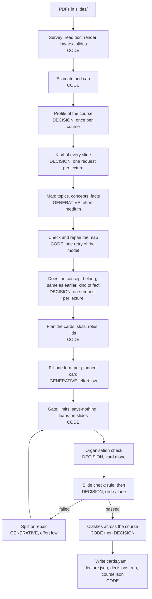
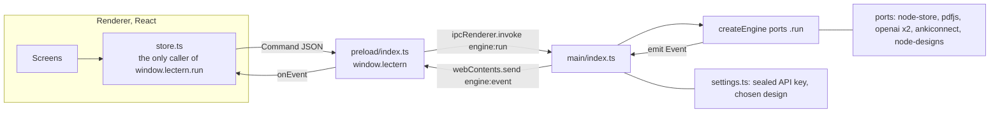

# Lectern v3: architecture

Written 2026-11-15 from the code on branch `v3` at `f42d826`, plus the eval harness and the
footer rule added the same day (`eval/refdeck.ts`, `slides.ts`). The code is the truth: where an
older document says otherwise, see "Where the docs lag the code" at the end. Anything not read
in code is marked unverified.

Lectern v3 turns a course's lecture PDFs into Anki cards. A student creates a course, drops in
one PDF per lecture, states a goal, and the app writes cards and sends them to Anki.

## 1. Layout of the repository

| Path | What it is |
|---|---|
| `packages/engine` (`@lectern/engine`) | The headless engine. Plain TypeScript, run by Node with type stripping, no build step, no interface code. Everything that makes cards lives here. |
| `packages/app` (`@lectern/app`) | The Electron desktop app. A shell and a React interface around the engine. |
| `design/v3/` | Design kit, card field contract (`cards/FIELDS.md`), and the Anki templates and six stylesheets the engine installs (`cards/anki/`). |
| `docs/v3/` | Brief, decisions, plans, reports, this file. |
| `eval-results/` | Git-ignored. Real course folders and run logs (`v3-courses/`). |
| `src/`, `src-tauri/` | **The old v2 app (Tauri), still shipping on `main`. Not part of v3.** `src/engine` is reference material for v3 (provider quirks), nothing imports it. The root `package.json` (`lectern-desktop` 2.17.0) belongs to v2. |

Engine runtime dependencies (`packages/engine/package.json`): `openai`, `pdfjs-dist`,
`@napi-rs/canvas` (renders slides to PNG), `yaml`, `zod`. Tests use `vitest` and `pdf-lib`.

### Engine source tree

```
src/api.ts            the boundary: Command, Event, createEngine(ports)
src/ports.ts          every dependency from outside: Store, PdfPort, ModelPort, DecisionsPort, AnkiPort, DesignsPort
src/build.ts          the build and estimate commands: the whole pipeline
src/ask.ts            the one place that spends money: metering and the cap
src/decide.ts         the closed lists, the decision questions, calibration table
src/mapper.ts         step 3 prompt and reply schema (the map)
src/tree.ts           code that checks and repairs the map
src/plan.ts           code that plans the cards
src/writer.ts         the card forms and the fill, repair and split calls
src/presets.ts        hand-written presets
src/clash.ts          look-alike cards across the course
src/cost.ts           the estimate and the cap constants
src/course.ts         the course folder: shapes, paths, read and write
src/slides.ts         slide text without the lines every slide repeats
src/library.ts        non-building commands: courses, course, cards, slide, create, add
src/edit.ts           slots, edit, remove, write (single cards)
src/deliver.ts        send and restyle (Anki)
src/outline.ts        Markdown outline; also the question/answer text of a card
src/cards/            roles, validate, assemble, slots, typed, id, words
src/adapters/         openai, pdfjs, node-store, node-designs, ankiconnect, memory-anki, offline, fake
src/cli.ts            command line: estimate, build, outline, send
eval/refdeck.ts       a run measured against a reference deck in Anki (section 14)
```

## 2. The three kinds of actor

Every step of the pipeline is done by exactly one of these. The design rule (brief, principle
5; `engine-decisions.md`, "How cards are created"): the model never decides how many cards exist
or what shape they take. Code owns numbers and structure, the generative model only writes words
into small forms, the decision model only answers closed questions.

**Plain code and rules (no model).** Reading PDFs, the estimate, checking and repairing the map,
planning the cards, ids, validators, markup, typed answers, tags, decks, the cap, all file and
Anki handling. Pure functions wherever possible.

**The generative model.** One port, `ModelPort` (`src/ports.ts:43`), one real adapter,
`openaiModel` (`src/adapters/openai.ts:62`). Provider OpenAI, Responses API, strict JSON schema
output, `store: false`. Default model id `gpt-6-luna` (the only other priced id is
`gpt-6.1-terra`, `openai.ts:6-13`); the CLI takes `--model`, the app uses the default. Four
tasks (`Task` in `ports.ts:9`), each with a closed reply schema:

| Task | Effort | Asked in | Returns |
|---|---|---|---|
| `map` | `medium` (`mapper.ts:80`) | step 5 below | title, topics, concepts, facts |
| `fill` | `low` (`writer.ts:313`) | step 10 | one filled form for one card type |
| `repair` | `low` | step 12 | the same form again, after rejection |
| `split` | `low` | step 12 | two or three forms of the same type |

Every request carries the whole lecture as `context` (slides as `[n] line / line`, slides under
100 characters of text also as PNG images), a `system` text (`mapper.ts:11`: "You only fill
forms ... Use only what the slides say, in the language of the slides ... no em-dashes") and a
`prompt`.

**The decision model.** One port, `DecisionsPort` (`ports.ts:71`), one real adapter,
`openaiDecisions` (`openai.ts:131`): OpenAI's Decisions API, `client.decisions.create`, model
`gpt-6-luna`, 0.10 dollars per million input tokens. It takes one shared input (text and
optional images) and a list of closed questions, and returns one answer per question and no
text. A question is a `predicate` (answer: a probability from 0 to 1) or a `choice` (answer: one
of the listed values and a confidence); a missing answer is a `refusal` and counts as no verdict
(`ask.ts:70`). Requests go out in chunks of 200 questions and at most 128 images
(`openai.ts:16-17`). The decision model returns no explanation and no accuracy figure; Lectern
sets thresholds itself (see section 6).

Both models go through `createAsk` (`ask.ts:32`), which meters every call.

## 3. The pipeline, step by step

`build` (`src/build.ts:161`) runs four course-wide phases that the app shows as the run screen:
`read`, `map`, `write`, `check`. Only PDFs not yet in `course.json` are built. Nothing is
written until every phase is through (`build.ts:606`), and `course.json` is written last.



### The whole pipeline in one table

| # | Step | Actor | Input | Output | File |
|---|---|---|---|---|---|
| 1 | Survey | code | PDF bytes | Text lines per slide without the lines every slide repeats (footer, page number); PNG (1024 px wide) for each slide with under 100 characters of text left | `build.ts:118`, `slides.ts`, `adapters/pdfjs.ts`, `cost.ts` (`LOW_TEXT_CHARS`) |
| 2 | Estimate and cap | code | characters, slide and image counts, goal, model prices | `estimate` event: cards, `costUsd`, `capUsd` | `cost.ts`, `build.ts:211` |
| 3 | Profile | decision model | First 6,000 characters of the new lectures' text | One of `concept`, `formula`, `programming`, `fact-heavy`; stored in `course.json`; picks the preset | `build.ts:215`, `decide.ts:79` |
| 4 | Kind of slide | decision model | The lecture as text plus its low-text images; one question per slide | One of `title`, `agenda`, `recap`, `reading list`, `content` per slide | `build.ts:233`, `decide.ts:87` |
| 5 | Map | generative model | The lecture, the preset's map rules, the names of all concepts of earlier lectures | `title`, topics, concepts (`core` flag), facts (text, slide, item count) | `mapper.ts` |
| 6 | Settle the map | code | The model's map, the slide kinds, earlier concepts | A tree that is always usable, plus a list of problems; one more model call when there are problems | `tree.ts:55` |
| 7 | Map checks | decision model | The lecture as text; questions: concept belongs, same as earlier concept, kind of fact | Flags (or, once calibrated, removal or merge); a kind for every fact | `build.ts:291`, `decide.ts:96-108` |
| 8 | Plan | code | Topics, goal, preset | A list of slots: concept, fact, card type | `plan.ts:24` |
| 9 | Ids | code | Slot, lecture, concept id, role | `<lecture>-<concept>-<role>-<n>` | `cards/id.ts`, `build.ts:372` |
| 10 | Fill | generative model | The whole lecture, concept, fact, card type, preset rules, one example of the type | One filled form (the card's slots) | `writer.ts:322` |
| 11 | Gate: rules | code | The slots | A list of problems, empty means pass | `cards/validate.ts:60`, `:187`, `:216` |
| 12 | Split or repair | generative model | The rejected slots, every problem, the same brief | A fixed form, or two or three forms | `writer.ts:327`, `:337` |
| 13 | Assemble | code | Passing slots, place in the course, slide text | Card fields: HTML, Slots, Typed, Source, Excerpt, Slide, Key | `cards/assemble.ts:99` |
| 14 | Copy check | code | Answer sentence, slide text | A flag when 8 or more slide words repeat in a row | `validate.ts:425`, `build.ts:468` |
| 15 | Organisation check | decision model | The card alone: question and answer | Probability that the card is about course organisation; at 0.2 or more the card is dropped | `build.ts:476`, `decide.ts:113` |
| 16 | Slide check | code, then decision model | Rule: answer terms against slide text. If unsure: the one slide (and its picture) as the whole input, all cards of a slide in one request | A flag, or once calibrated a rejection | `validate.ts:387`, `build.ts:494` |
| 17 | Clashes | code, then decision model | Questions of new cards against earlier and new cards | Identical question: dropped by code. Look-alike pair: probability that the two test the same thing | `clash.ts`, `build.ts:564` |
| 18 | Save | code | Everything accepted | `cards.yaml`, `lecture.json`, `decisions.json`, `runs/NNN.json`, `course.json` | `build.ts:606` |
| 19 | Send | code through AnkiConnect | Cards not yet in Anki, a card design | Decks, note types, media, notes | `deliver.ts:204` |

### Step by step

**1. Survey (code).** `survey` (`build.ts:118`) lists `slides/*.pdf` in course order (by file
name, numbers compared as numbers, `course.ts:165`), skips files already listed in `course.json`,
reads text per slide with pdf.js, drops the lines that at least half the slides repeat (footer,
page number, compared without digits, `slides.ts`), and renders every slide with fewer than 100
characters of text left (`LOW_TEXT_CHARS`, `cost.ts`) to a 1024 pixel PNG. No slide is left out for lacking text: the
model gets to see the picture. Each lecture gets a number: the leading number of the file name
if free, otherwise the next free one, and it keeps that number forever (`course.ts:175`). This
step also serves `estimate`, which renders pictures locally and calls no model.

**2. Estimate and cap (code).** See section 5. The `estimate` event is emitted before the first
paid call.

**3. Profile (decision model, once per course).** One `choice` question over the first 6,000
characters of the new lectures' text (`PROFILE_CHARS`, `build.ts:78`). A refusal falls back to
`concept` with confidence 0. A student's `profile` on the command skips the model and stores
confidence `null`. The result is stored in `course.json` and the `profile` event is emitted.
Later builds reuse it (tested: "does not ask for the profile again"). It picks the preset
(section 7).

**4. Kind of slide (decision model).** One request per new lecture, the whole lecture as shared
input and one `choice` question per slide: title, agenda (also organisation such as dates,
grading and exercise instructions), recap, reading list, content (`decide.ts:87`). A missing or
invalid answer becomes `content`. `slideKind` is uncalibrated (`decide.ts:51`), so the label does
not remove any slide from the map. It only becomes the stated reason when the map leaves the
slide unused ("Title slide", "Agenda slide", ... or "No testable fact found on this slide",
`tree.ts:47`). Once calibrated, `contentOnly` would refuse facts on non-content slides
(`build.ts:278`, `tree.ts:59`).

**5. Map (generative model).** One call per lecture (`mapper.ts:72`), effort `medium`. The
model gets the whole lecture, the preset's `mapRules`, and the names of every concept earlier
lectures introduced (told to reuse exactly that name when a concept comes back). It returns the
lecture title (at most 32 characters), topics, concepts (name of at most 6 words, `core` true or
false) and facts (one sentence, the one slide that states it, `items` for a list to recite). It
sees no card limits here and decides nothing about cards.

**6. Settle the map (code).** `settleMap` (`tree.ts:55`) checks the map and repairs it itself:
empty or too long title, unnamed or over-long concept names, facts on slides that do not exist,
facts without text, more than 6 facts per concept (cut), duplicate concept ids (slug of the name;
the duplicate is dropped), no core concept (then all are core), content slides no fact uses. It
returns the repaired tree and the list of what the model got wrong. When the list is not empty,
`build` asks the model once more with the problems and the previous list (`build.ts:283-289`)
and takes the second result whatever it contains, repaired again by code. A concept whose id
exists in an earlier lecture keeps the stored name and gets `since: <lecture>` (one vocabulary).

**7. Map checks (decision model).** One request per lecture over the whole lecture, holding
three kinds of question (`build.ts:301`):

- *Concept belongs*: predicate "This lecture teaches the concept X", one per concept.
- *Same concept*: predicate "X in this lecture and Y from an earlier lecture are the same
  concept". Code first picks the pairs: a new concept against each earlier concept whose name
  shares at least half of its words (`SAME_NAME = 0.5`, `build.ts:76`).
- *Kind of fact*: a `choice` among `definition`, `contrast`, `list`, `sequence`, `formula`,
  `code`, `case`, `diagram`, `cause`. Invalid answer falls back to `definition`.

Outcomes (`build.ts:309-330`): concept below its threshold is flagged "may not belong to this
lecture" (calibrated: removed); a same-concept probability at or above its threshold is flagged
(calibrated: merged into the earlier concept, or removed if the lecture already has that id).
The fact kind is always applied. All of these are uncalibrated today, so they flag and keep.

**8. Plan (code).** `plan` (`plan.ts:24`) is a pure function and the only place that decides how
many cards exist:

- Goal `pass`: only concepts the map marked `core`, one fact each. `good`: every concept, up to
  2 facts. `top`: every concept, up to 4 facts, and every `case` and `contrast` fact beyond that
  (`GOAL_PRESETS`, `cards/roles.ts:207`).
- The facts taken are the first ones in the order the model listed them. Nothing ranks them.
- A concept that an earlier lecture introduced gets exactly 1 more card (`RECURRING_CARDS`), its
  first fact, whatever the goal.
- The kind of a fact and the preset pick the card type from `preset.plan[kind]`, taken in turn
  within one concept (`turn % roles.length`). A `list` fact of exactly 2 items becomes `name-two`.
- Concepts that the goal leaves without cards are returned as `outsideCore` and later written to
  the decisions file.

**9. Ids (code).** `cardId` (`cards/id.ts`) is `<lecture>-<concept id>-<role>-<n>`. The wording is
not part of it, so a reworded card keeps its id, its place in the file and its Anki note. Ids are
fixed before a word is written (`build.ts:372`).

**10. Fill (generative model).** One call per planned card (`writer.ts:322`), effort `low`. The
input is the whole lecture again (cached by the provider), the concept name, the fact and its
slide, the card type with a one-line description (`ROLE_SPECS[role].use`), the preset's `rules`,
and the preset's example of that card type. The reply schema is a small form per card type
(`FORMS`, `writer.ts:92`) with the limits written into the field descriptions: for example a
definition has `question`, `answer`, `extra`; a contrast has `question`, two sides, two values,
`extra`. The model never writes HTML, list markup, slot labels, cloze numbers of a list, or any
provenance field. Calls run four at a time (`PARALLEL`). The first card of each card type in a
lecture runs ahead of the others to fill the provider's prompt cache (`build.ts:416-428`).

**11. Gate (code).** For every filled card, `validateDraft` (all hard limits, section 9), then,
only if that passes, `leansOnSlides` (the question points at the slides or the session, a word
rule in English and German) and `saysNothing` (the answer repeats the question, a sentence only
turns the question around, a contrast side repeats its own label). Problems are sentences written
so that a model can act on them.

**12. Split or repair (generative model).** Cards that fail go back, at most twice (`REPAIRS`,
`build.ts:70`). A card that breaks a length limit (`tooLong`, `validate.ts:401`) and is not yet a
part is *split*: the model returns two or three atomic forms (`SPLIT_INTO = 3`), the first part
keeps the id, the others get new ids, and each part goes through the gate again but is never split
again. Every other failure is *repaired*: the same form again with the previous attempt and the
full list of problems. A card that still fails after two rounds is dropped and listed in
`lecture.json` with concept, role, question and reasons.

**13. Assemble (code).** `assemble` (`cards/assemble.ts:99`) builds every field from the slots:
escaped HTML with `==x==` turned into `<mark>`, `Back` by role, `Slots` labels, cloze text for
`cloze` and `cloze-list` (the list items become `{{cN::...}}` items), `Typed` (section 9),
`Source` ("Lecture 2, slide 14"), `Excerpt` (the slide line sharing most terms, at most 30
words), `Slide` (an `` named `l02-s14.png`), `Diagram` (the slide image, no renderer yet),
`Key` (the concept name). `Asked` and `Part` stay empty until past exams exist.

**14. Copy check (code).** A flag, never a rejection, when the answer sentence repeats 8 or more
slide words in a row (`COPY_RUN`).

**15. Organisation check (decision model).** One request per passing card, the card alone as the
input (`cardInput`, `decide.ts:64`): predicate "This flashcard is about the organisation of the
course: the lecturer, dates, grading, exam rules, assignments, reading lists, guest visits or
instructions for a class exercise." This check is calibrated with threshold 0.2
(`decide.ts:56`): at or above it the card is dropped at once with the reason "is about the
organisation of the course, not its subject", with no repair, because no rewording fixes such a
fact. Below, nothing happens.

**16. Slide check (code, then decision model).** The free rule `groundedByRule`
(`validate.ts:387`) passes a card when at least half of its answer terms (words of four letters or
more, compared by their first five letters) are on the slide text. Formula cards and slides the
model saw as a picture are never settled by the rule. Cards it cannot settle go to the decision
model with the slide alone as the input (`slideInput`) and the predicate "This slide supports this
flashcard. Question: ... Answer: ...". Below the threshold: flag "the answer may not be on its
slide" (calibrated: reject for repair with "slide N does not support this answer").
Uncalibrated today.

**17. Clashes (code, then decision model).** `findClashes` (`clash.ts:28`) compares each new
card's question, as a set of lowercase words, with all earlier cards and the new ones before it.
Same word set: dropped by code regardless of calibration, reason "asks the same question as
<id>". Sharing at least 0.6 of the words (`ALIKE`): sent as a pair to the decision model (predicate
"These two flashcards test the same thing"). Outcome (`build.ts:586-595`): below half the
threshold nothing; between half and the threshold a flag "looks like <id>"; at or above, a
flag "may test the same thing as <id>" while uncalibrated, or a drop once calibrated. An
existing card is never the one that is dropped. No card is rewritten here.

**18. Save (code).** Per new lecture: `cards.yaml` (the accepted cards, with `flags` where a check
had a remark), `lecture.json` (the tree, left-out slides with reasons, dropped cards), then
`decisions.json` (lines written by code from facts: goal, profile, left out, outside core,
recurring concepts, concepts without a card, dropped counts), `runs/NNN.json` (model, decision
model, preset, goal, calls, decisions, tokens, estimate, cost, durations per phase) and last
`course.json`. Because `course.json` lists a lecture only when everything else is saved, an
interrupted build never leaves a half-built lecture counted as built.

**19. Send (code).** Section 10.

### Events of a build

A build emits, in order: `phase` read started, `estimate`, `profile`, `progress` per lecture in
`read`, `phase` read done, `phase`/`progress` for `map`, `write`, `check`, then `built`
(lectures added, cards, dropped, flagged, cost, duration). With nothing new to build it emits
`phase` read started and done and an empty `built`. A failure ends in `failed` with a message and
a fix, never a throw (`api.ts:240`).

## 4. Where each decision is made

| Judgement | Question to the decision model | Input | Threshold, outcome |
|---|---|---|---|
| Kind of course | choice of 4 | first 6,000 chars | fallback `concept` |
| Kind of slide | choice of 5, one per slide | lecture + low-text images | label only becomes a reason (uncalibrated) |
| Concept belongs | predicate | lecture | below 0.5: flag (calibrated: remove) |
| Same concept | predicate, for look-alike names | lecture | at or above 0.5: flag (calibrated: merge) |
| Kind of fact | choice of 9 | lecture | always applied |
| About course organisation | predicate | the card alone | at or above 0.2: drop, calibrated |
| Slide supports the card | predicate | the slide alone | below 0.5: flag (calibrated: repair) |
| Same card | predicate, for look-alike pairs | pair of cards | 0.25 to 0.5: "looks like"; 0.5 and up: flag (calibrated: drop) |

Thresholds are in `CALIBRATIONS` (`decide.ts:50`). Uncalibrated checks use `{ calibrated: false,
threshold: 0.5 }`. The rule from `engine-decisions.md`: a check that has not been measured on
labelled data flags and never drops. Only `organisation` has been measured. `Options.calibrations`
on `createEngine` can override the table (the tests do).

## 5. Where money is spent, the estimate and the cap

Money is spent in exactly two places, both wrapped in `createAsk` (`ask.ts:32`): each generative
model call and each decision request. Nothing else in the engine calls the network except
AnkiConnect on `127.0.0.1`.

- **Generative model**: `openaiModel` computes the dollar cost of each call from the usage the API
  returns: uncached input at `input`, cached input at `cachedInput`, output (reasoning included)
  at `output`; for `gpt-6-luna` that is 0.10, 0.01 and 0.50 dollars per million tokens, and when a
  request has more than 272,000 input tokens the long-context prices (0.20 and 0.75) apply to the
  whole request (`openai.ts:6-13`, `:109-113`).
- **Decision model**: input tokens only at 0.10 per million. Cached input is billed at the full
  price here as an upper bound, because the real discount is not published (`openai.ts:168`).
- A reply that fails the zod schema is asked once more, so a call can be billed twice
  (`ask.ts:52`); after two bad replies the build fails.

**Estimate.** `estimate()` in `cost.ts` is a pure function of per-lecture characters, slides and
image counts, the goal and the two price lists. Its constants (quoted from the file, fitted to the
two full runs of 2026-11-14): 0.25 tokens per character, 1,000 per image, 0.8 concepts per slide
(0.65 of them core for `pass`), at most 2.4 facts per concept actually planned, 25 percent
rework on top of the fill calls, 10 uncached calls per lecture, 350 decision tokens per card.
Reasoning on the map is counted as 250 output tokens per slide. The result is the `estimate`
event: lectures, slides, cards, `costUsd`, `capUsd`. The `estimate` command shows it without any
model call; `build` emits it before the first paid call.

**Cap.** `capUsd = max(3 x estimate, 0.25 dollars)` (`CAP_MULTIPLE`, `CAP_FLOOR_USD`), or the
command's own `capUsd` (CLI `--cap`). After every paid call, `spend` adds the usage to the meter
and throws an `EngineError` when the real cost is above the cap (`ask.ts:37-48`). Consequences,
read from the code and the test "stops a build whose real cost passes the cap, starts no further
call and saves nothing":

- The check happens after a call, so the call that crosses the cap is already paid, and up to
  four calls in flight finish (`pool`, `build.ts:746`; after the first failure no new item starts).
- The run fails with "Nothing was saved". A stopped run loses its paid work (the report lists
  checkpoints per lecture as an open item).
- The app passes no `capUsd`, so it always uses 3 times the estimate.

**What the student is shown.** The working tree (uncommitted) adds `costEur` to the estimate:
euros at a fixed 0.9 per dollar, rounded up to 5 cents up to 50 cents, 10 cents up to one euro,
50 cents above (`shownEuros`). The app's bottom bar (also uncommitted) shows "About N cents" from
it. In the committed state the bar shows dollars.

**Policy for paid runs** (`HANDOFF.md`, `engine-decisions.md`): only the engine session starts
them, on OpenAI only, within a 50 dollar budget agreed with Steffen. Reference cost: 11 decks, 356
slides, about 17 to 19 cents on `gpt-6-luna` (engine report).

## 6. Calibration and flags

A flag is a short text stored on the concept (`lecture.json`) or the card (`cards.yaml`,
`flags`). The app shows them ("Worth a look", `CardsPanel.tsx`). Per the engine report, the
flags of the first runs did not find the real defects (in the concept run 21 of 24 flagged cards
were sound); the organisation check and the word rules in `validate.ts` were added for that
reason. The report's measurement of the slide check (2026-11-15, 66 cards, own slide against a
far-away slide) is why the slide check now gets one slide as its input: with the whole lecture
the model said yes to 50 of 66 wrong slides, with the slide alone to 12. The concept check still
gets the whole lecture (`decide.ts` comments and `build.ts:301`). The measurements were made by
scripts that are not in the repository.

## 7. Presets and profiles

A **profile** is the kind of course: `concept`, `formula`, `programming`, `fact-heavy`
(`PROFILE_KINDS`, `decide.ts:9`). A **preset** (`presets.ts:15`) is the hand-written method for a
kind:

- `plan`: which card types a fact of each of the nine kinds becomes (taken in turn),
- `examples`: one filled form per card type, shown to the model,
- `mapRules`: what counts as a concept and a fact,
- `rules`: how a card is worded.

There are two presets (`PRESET_IDS`): `concept` and `placeholder`. `presetFor` (`presets.ts:173`)
gives `concept` to concept courses and `placeholder` to the other three kinds. The `concept`
preset was written from Steffen's Entrepreneurship study kit and accepted by him on 2026-11-15
as the working preset (`engine-profile-concept.md`). Its map rules forbid course organisation
as a concept and ask for several angles per idea; its card rules say to lead with the key term,
one fact per answer, about 12 words, a context prefix when a rival answer exists. The
`placeholder` only exists so the pipeline runs on any course and says nothing about quality.
Both share one `plan` table:

| Fact kind | Card types, in turn |
|---|---|
| definition | definition, reverse |
| contrast | contrast |
| list | cloze-list (name-two when exactly 2 items) |
| sequence | chain |
| formula, code, case, diagram | formula, code, case, diagram |
| cause | why |

A build command can override the kind (`profile`) or the preset (`preset`, for trying a draft).
The three other presets (formula, programming, fact-heavy) are not written; Steffen has to
approve each one before it ships (`engine-decisions.md`).

## 8. Card kinds and roles

The closed set of 12 card types, called roles (`ROLES`, `cards/roles.ts:6`). Each has a `RoleSpec`
with the note type, how many answers and labels, how `Back` is built, and a one-line `use` for
the prompt:

| Role | Note | Answers | Labels | Back |
|---|---|---|---|---|
| definition | qa | 1 | 0 | sentence, key term marked |
| reverse | qa | 1 | 0 | one term |
| contrast | qa | 2 | 2 | two bullets |
| chain | qa | 1 to 2 | 1 to 4 | list |
| name-two | qa | 2 | 0 | two bullets |
| why | qa | 1 to 2 | 0 | sentence, or two bullets |
| case | qa | 1 | 0 | one term |
| formula | qa | 2 (TeX, condition) | 0 | formula plus sentence |
| code | qa | 1 to 2 | 1 to 2 | list, with a listing |
| diagram | qa | 1 | 0 | sentence; diagram data, slide image shown |
| cloze | cloze | 0 | 0 | sentence with 1 to 5 deletions |
| cloze-list | cloze | 2 to 5 | 0 | lead-in with one deletion per item |

`diagram` carries a structured description (`matrix`, `sequence` or `cycle`) with its own
validator; there is no renderer, so the card shows the slide image (`assemble.ts:121`). Note
types in Anki are `Lectern Q&A` (16 fields) and `Lectern Cloze v3` (13 fields), the fields of
`design/v3/cards/FIELDS.md` (`deliver.ts:19-30`).

## 9. Validation rules and hard limits

`LIMITS` (`cards/validate.ts:18`), quoted:

| Limit | Value |
|---|---|
| Front (question) | 20 words, never a yes/no opener (English and German list, `YES_NO`) |
| Answer, all answers together | 25 words |
| Bullets in a list or steps answer | 2 |
| Term answer (reverse, case) | 5 words |
| Extra | 40 words |
| Cloze sentence | 45 words, 1 to 5 deletions, each at most 8 words, numbered c1.. once each, no hints, balanced braces, at least 3 words of cue |
| Cloze list | lead-in 20 words, each item 8 words, 2 to 5 items |
| Slot label | 4 words |
| Code listing | 16 lines, 60 characters per line, every line must be found on the slide (skipped when the slide was seen as a picture) |
| Diagram | matrix axes 1 to 4 labels, cell count equals columns times rows; sequence or cycle 2 to 8 steps; labels 4 words; `key` indexes valid |
| Key term marks | at most one `==term==` per answer; definition requires one |

Further rules in `validateDraft` (`validate.ts:60`): the role exists, answer and label counts
match the role, no empty slot, plain text only (no line breaks, no HTML except `<sub>` and
`<sup>`, no Markdown bold, no `$` maths), the cited slide is a slide of the concept, only `code`
takes a listing, only `diagram` takes a diagram. Outside `validateDraft`: `leansOnSlides` and
`saysNothing` (section 3, step 11), which apply to model-written cards only.

**Typed answers** are decided by code alone (`cards/typed.ts`): only for `reverse`, `case`,
`cloze`, `cloze-list`, only when every expected text is at most 3 words and 30 characters with no
maths, code, markup or line break. Q&A: the term in the concept's stored casing (Anki compares
case-sensitively); cloze: the word `on`.

## 10. The course on disk

A course is a folder of plain files, no database (`course.ts:1-11`). The store root is the
library folder; a command carries the course as a folder name.

```
<course>/
  slides/*.pdf                    input, one PDF per lecture
  course.json                     format, name, goal, profile, lectures: number, title, file, sha256, slides
  lectures/02/lecture.json        tree (topics > concepts > facts), left-out slides with reasons, dropped cards
  lectures/02/cards.yaml          the cards of the lecture, one readable file
  decisions.json                  decisions taken, one line each, written by code
  runs/001.json                   one file per build: models, preset, tokens, cost, estimate, durations
  anki.json                       deck chosen, and the Anki note id of every card sent
```

Properties that hold by construction and by test:

- A lecture that is listed in `course.json` is never built again. Adding a lecture leaves the
  files of earlier lectures byte-identical (test "leaves every existing lecture file
  byte-identical").
- A lecture keeps its number forever (`assignNumbers`); a PDF is known by its file name, and
  `add` refuses a name the course already has. A changed PDF behind a built lecture is ignored
  (engine plan, "Deferred"; the sha256 is stored, nothing compares it).
- Card files hold the fields exactly as they go to Anki (HTML), plus `id`, `note`, `concept`,
  `slide`, and optional `diagram`, `flags`, `own`. The Slide picture is not saved in the course
  folder: the `slide` command and `send` render it from the PDF on request.
- `createCourse` makes the folder name from a slug of the name and never reuses one.

## 11. The boundary between the interface and the engine

One function: `createEngine(ports).run(command, emit)` (`api.ts:177`). Commands in and events
out, both plain JSON, so the in-app channel can later be swapped for HTTP. A command is parsed
with a zod discriminated union (`CommandSchema`, `api.ts:47`); a bad command, or any thrown
`EngineError`, becomes a `failed` event with `message` and `fix`. Nothing throws out of `run`.

| Commands | Model or network? | Answered by events |
|---|---|---|
| `build`, `estimate` | `build` calls both models, `estimate` neither | `phase`, `progress`, `estimate`, `profile`, `built` |
| `courses`, `course`, `cards`, `outline`, `create`, `add`, `slide` | no model | `courses`, `course`, `cards`, `outline`, `created`, `added`, `slide` |
| `send`, `restyle` | AnkiConnect only | `sending`, `sent`, `restyled` |
| `slots`, `edit`, `remove`, `write` | none (Anki when the card is there) | `slots`, `edited`, `removed`, `written`, `refused` |

The engine touches no file system, network or PDF library itself. `Ports` (`ports.ts:158`) are
passed in: `store`, `pdf`, `model`, `decisions`, `anki`, `designs`, `now`.



The app side (`packages/app`):

- `src/shared/contract.ts` re-exports the engine's own types (`Command`, `Event`, `CardFile`,
  `CourseState`, ...), so a change of the boundary fails the app's typecheck.
- `src/main/index.ts`: handler `engine:run` builds an engine per command through `engineFor`
  (`src/main/engine.ts`), runs it and sends each event to the window as `engine:event`, then
  returns how many events it sent. The preload script waits for that many before the call
  resolves, because the "finished" answer can overtake the last events (`preload/index.ts`).
- `engine.ts` wires the ports: `nodeStore(courses)`, `ankiConnect()`, `nodeDesigns`, `pdfjsReader`,
  `openaiModel` and `openaiDecisions` with the stored key. With `LECTERN_FAKE=1` it uses the
  offline models and a module-level `memoryAnki` instead. The card designs are read from
  `design/v3/cards/anki` in the repository.
- `src/main/settings.ts` holds what is not engine business: the chosen card design
  (`settings.json`) and the OpenAI key, sealed with Electron's `safeStorage` (`openai.key`).
  `OPENAI_API_KEY` in the environment wins. The key never reaches the renderer.
- `src/renderer/src/store.ts` is the one zustand store and the only file that calls
  `window.lectern.run` (plus `SlideThumb.tsx` for slide pictures and `CopyForChat.tsx` for the
  outline). A course's stage is derived (`stageOf`): `empty`, `setup` (PDFs pending), `running`,
  `ready`. The interface sends `build` with only `course` and `goal`; it never sets `profile`,
  `preset` or `capUsd`.
- Screens: first run (provider and key), courses, the course (a full-width map of lectures, a
  lecture as rings, a bottom bar, one side panel for setup, run, cards, details), settings with
  the six card designs. Design is binding in `design/v3/KIT.md`; the app's rules are in
  `packages/app/README.md`.
- Commands to run it: `pnpm --filter @lectern/app start`, with `LECTERN_FAKE=1` for the offline
  models and an Anki in memory. Environment: `LECTERN_FAKE_DELAY`, `LECTERN_COURSES`,
  `LECTERN_DATA`.

## 12. Sending to Anki

`send` (`deliver.ts:204`) needs Anki open with the AnkiConnect add-on (`127.0.0.1:8765`,
`adapters/ankiconnect.ts`, API version 6, 30 second timeout). It is the only delivery path.

1. Cards not in `anki.json` are collected per lecture. None waiting: fails with "Every card of
   this course is already in Anki."
2. `applyDesign`: installs or restyles the two note types in the chosen design (`native`,
   `structure`, `lamp`, `colours`, `afterglow`, `vitrine`; `designs.ts`). A note type is Lectern's
   to restyle only while its stylesheet starts with `/* lectern-notetype v<n> skin:`; a student who
   edits the styling removes the line and owns it. Fonts are stored in lowercase names.
3. The course deck is chosen once and kept: the course name, or `<name> (Lectern)` when the
   student already has a deck of that name. One subdeck per lecture,
   `Course::02 Effectuation`.
4. Per lecture: the slide pictures are rendered from the PDF and stored as
   `lectern-<course>-l02-s14.png` (lowercase), then each card is added as a note with tags
   `<course>::lecture::02`, `<course>::role::<role>` and, for the student's own cards,
   `<course>::own`. Duplicates are allowed (Anki would refuse an equal first field).
5. Anki can hand back a note id for a note that is then gone (an undo by the student while the
   send runs removes Lectern's newest note). So the send asks Anki which notes exist, re-adds the
   missing ones up to 3 times, and checks everything once more at the end; the count of notes
   that did not stay is the failure message. Only notes found in Anki are recorded. `anki.json` is
   saved in a `finally`, so an interrupted send continues with the rest.

A card is sent once: a note in Anki is never rewritten by a later send, and a note the student
deleted does not come back. Lectern does not touch any deck options or preset.

**Editing, removing, own cards** (`edit.ts`, `cards/slots.ts`):

- `slots` returns a card as a form holds it (role slots in plain text, key term apart from the
  answer, hidden parts of a gap sentence as a list) with the word limits, or blank slots for a
  new card. `toSlots` reads the stored fields back (the reverse of `assemble`).
- `edit` checks the form with `checkSlots` (messages written for a student), then
  `validateDraft`, then `assemble`. The role cannot change. The card keeps its id, slide and
  place. The code listing check is skipped (`seenAsImage: () => true`) because a student may write
  what the slide only shows. If the card is in Anki, `updateNote` changes the note and keeps its
  progress; Anki is touched first, so with Anki closed nothing changes anywhere. A note the
  student deleted in Anki is forgotten and the card counts as not sent.
- `remove` deletes the note in Anki if there is one, then the card from `cards.yaml`.
- `write` adds a card of the student's own to a concept: only `definition` (question and a
  one-sentence answer) or `cloze` (a sentence with gaps). The id takes the next free number,
  the slide is the first slide of the concept, `own: true` is set. It goes to Anki with the next
  send. `leansOnSlides` and `saysNothing` are not applied to the student's wording.
- `restyle` gives the note types already in Anki another design and changes no note; while no
  course has been sent it changes nothing and needs no Anki.

## 13. Offline models and tests

The pipeline never needs a network in tests. Everything outside the engine sits behind a port, so
tests pass scripted or in-memory versions:

- `adapters/fake.ts`: `scriptedModel(reply, costPerCall)` and `scriptedDecisions(answer)`. They
  record every request, so tests assert what the model was shown (for example that every card call
  carries the whole lecture and that card checks have the card as the only input). A scripted
  model can charge a fixed cost per call, which tests the cap.
- `adapters/offline.ts`: `offlineModel` and `offlineDecisions` need no script. They turn the text
  of any slides into a small course (slide 1 is the title, each later slide with a heading and
  lines becomes a concept, each line a fact, each card made of the slide's words). Decisions say
  yes to belongs and supports, no to same-concept, same-card and organisation. Cost is zero. They
  say nothing about real card quality. The app uses them with `LECTERN_FAKE=1`.
- `adapters/memory-anki.ts`: an Anki in memory that refuses what the real one refuses (unknown
  note type, field or deck, closed Anki) and models media and notes.
- `test/helpers.ts`: real PDFs made with `pdf-lib`, a temp folder per test. The pipeline test uses
  the real pdf.js reader and renderer and real files; only the two models are scripted.

Test files: `pipeline`, `validate`, `plan`, `tree`, `library`, `edit`, `deliver`, `cards`, and
`openai.live` (2 tests, skipped unless `LECTERN_LIVE=1`; they cost a fraction of a cent).
`pnpm --filter @lectern/engine test` gave 225 passed, 2 skipped on 2026-11-15 (working tree), and
`pnpm --filter @lectern/engine typecheck` was clean. `pnpm --filter @lectern/app test` gave 53
passed and its typecheck was clean. The app's Playwright test (`test:e2e`) runs the whole way
from a new course to its cards in the in-memory Anki on the offline models; it was not re-run
for this document.

## 14. Evals against the reference deck

**The harness is `packages/engine/eval/refdeck.ts`.** It calls no model itself. Four steps:

| Step | Command | Writes |
|---|---|---|
| Reference deck out of Anki | `node eval/refdeck.ts reference <anki deck> <eval folder>` | `reference.json`: question, answer, source and asked count per note |
| A built course | `node eval/refdeck.ts run <course folder> <eval folder>` | `cards.json`, `cards.txt`, `facts.json` (the map), `slides.txt` |
| Work for the judge | `node eval/refdeck.ts batches <eval folder> [--size 40]` | `batches/NN.json` |
| Count | `node eval/refdeck.ts report <eval folder>` | prints the table |

A judge answers each batch into `labels/NN.json` following `eval/JUDGE.md`. Per reference note
it says `match` (same fact, concept only, nothing) and, for a miss, `stated`: whether the slide
text states the fact, a slide only shows it in a picture, or the slides do not have it. So far
the judge has been Claude Haiku, one subagent per batch, spot-checked by hand. It is not a blind
comparison by a person. `report` gives coverage overall, by where a missed fact is, by how often
the exam asked, and by subdeck.

- **Real builds**: `node packages/engine/src/cli.ts estimate <course folder>` (free), then
  `build` with `OPENAI_API_KEY` set. Course folders, logs and eval folders go to `eval-results/`
  (git-ignored): courses under `v3-courses/`, judged runs under `v3-eval/`.
- **The reference deck** is Steffen's Entrepreneurship deck in Anki: 636 notes for the same 11
  decks, selected by the exam (each note carries how often 22 past papers asked it). 132 notes
  cite no slides. It is not in the repository.
- **A second course** for a held-out check: Grundlagen Datenbanken, 9 chapters, 708 slides. Its
  deck (AnkiTUM `IN0008_GDB`, YAML files, about 140 cards by another student, not atomic) is a
  much weaker reference, and `refdeck.ts` does not read that format yet.
- **Not in the harness**: the per-card labels (organisation, broken, thin) and the decision
  model as a grader. Their scripts from 2026-11-14 are kept outside git in
  `eval-results/v3-eval/2026-11-14-quality-session/`.
- **Live adapter test**: `LECTERN_LIVE=1 OPENAI_API_KEY=... pnpm --filter @lectern/engine test`.
- **v2's harness** `src/engine/models.eval.test.ts` (env `LECTERN_EVAL=1`) belongs to the old app.

Results so far are in `engine-report.md`. In short: the 11 decks become about 550 to 600 cards
for under 20 cents on `gpt-6-luna` with no hard-limit violation; with the `concept` preset 30
percent of the reference notes have a card on the same fact (strict judge, 2026-11-15). Of the
misses, a third are stated in the slide text, a quarter are only in a picture, and nearly half
are not on the slides at all.

## 15. Where the docs lag the code

- `engine-plan.md` (milestone 1 text) describes a `CheckPort`, an Anthropic adapter, `prompts.ts`,
  one JSON file per card, ten roles and a `ModelPort.complete({ task, system, prompt, schema })`.
  The code has `DecisionsPort`, only the OpenAI adapters, prompts in `mapper.ts` and `writer.ts`,
  one `cards.yaml` per lecture, twelve roles, and a request with `context`, `images`, `effort`.
  Its "changed by" table is closer but still lists "a no sends the card back for a rewrite" as
  fact: in code that only happens for a calibrated check, and only the organisation check is.
- `engine-plan.md` lists two validator rules that are not validators: "at least one answer term
  found on the cited slide" (it is the slide check, rule then decision, flag only) and "no
  duplicate front within the course" (it is `findClashes`, step 17).
- `engine-decisions.md` states 400 questions per decisions request; the adapter sends 200,
  following the SDK's documented 1 to 200 (the report says so).
- `engine-decisions.md` decision 7 says "stop cleanly"; the code fails the whole build and saves
  nothing, after the call that passed the cap.
- `engine-decisions.md` decision 11 says recurring concepts get more cards; the code gives
  exactly one more, the first fact, whatever the goal.
- `engine-decisions.md` step 2 says non-content slides are left out; uncalibrated, the label is
  only the reason (the report states this).
- `HANDOFF.md` says 158 engine tests; the count is 225 (plus 2 skipped). Engine source is about
  5,300 lines now against "3,800" in the report.
- `brief.md` lists tags for exam part and exam weight, a card role "case anchor", a Lectern deck
  preset, and "Lectern only touches its own Anki preset". The code writes tags for lecture, role
  and own; it has no exam-part or weight tags (no past exams yet) and touches no deck options.
- `engine-report.md` says the Slide field "names a PNG that nothing saves". Still true for the
  course folder, but `send` now renders and stores the pictures in Anki's media folder.
- `engine-decisions.md` expects the card file to be readable like the study kits; it holds field
  HTML (the report raises this as open).

## 16. Surprising, inconsistent or unverified

- `cloze` is never planned. No fact kind maps to it in either preset, so only a student's own
  card can have that role; the `cloze` example in the `concept` preset is never shown to a model.
  `name-two` is reached only from a `list` fact with exactly 2 items.
- The profile is decided and stored but the app never shows or lets the student change it, and
  only the `concept` preset exists. A formula or programming course is still written with the
  placeholder.
- Five of the six checks are unmeasured and only flag. Only `organisation` (0.2) acts. So at
  present the pipeline drops cards for: failing hard limits after two repairs, organisation,
  identical questions, and nothing else.
- The concept-belongs check still gets the whole lecture, although the report's measurement says
  the concept's own slides separate better (99 against 95 percent).
- The cap can be exceeded by the last call and up to four in-flight calls, and a stopped run
  loses all its paid work.
- `survey` (also used by `estimate`) renders low-text slides to PNG locally, so an estimate is
  free but not instant.
- Unverified: the OpenAI prices in `openai.ts` against a bill (the report says so); whether
  `gpt-6-luna` accepts an effort lower than `low`; the quality of cards in Anki on a phone; the
  app's own send, edit and remove against a real Anki (the engine's ran against one on 2026-11-15,
  the app's only against the in-memory Anki).
- Uncommitted work present while this was written: `costEur` in `api.ts` and `cost.ts`, plus
  related edits in `BottomBar.tsx`, `dev/fixture.ts`, `e2e/shots.spec.ts` and two engine tests.
